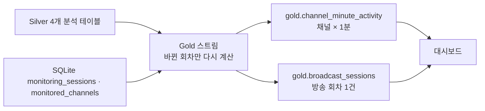

# Gold 테이블 설계 및 데이터 계약 v1

작성일: 2026-10-14. 상태: **Gold 스트림·전체 재계산 구현 및 실제 데이터 대조 완료, 대시보드 미구현**. 방식을 고른 근거는 [Gold 실시간 갱신 방식 결정](decisions/2026-10-18-gold-live-refresh.md)에 있다. 입력: Silver 파서 계약 `silver-v3.2` ([Silver 계약](silver-data-contract.md)).

Gold의 목적은 채널별 채팅·후원·구독 알림 흐름을 대시보드에서 바로 그릴 수 있는 집계 테이블을 만드는 것이다. 포트폴리오 데모에서 방송 한 회의 흐름과 요약을 보여주는 것을 1차 사용처로 한다.

## 1. 테이블과 한 행의 의미

| 테이블 | 한 행의 의미 | 주 사용처 |
|---|---|---|
| `gold.channel_minute_activity` | 한 채널의 KST 1분 구간 동안 Silver 이벤트 집계. 이벤트가 1건 이상인 분만 저장 | 방송 중 채팅량·참여자·후원 시계열 차트 |
| `gold.broadcast_sessions` | Collector `monitoring_sessions`의 모니터링 회차 1건 | 방송 요약 카드, 회차 간 비교, 수집 누락 표시 |

- 날짜는 **방송 날짜(`broadcast_date_kst`)** 하나만 쓴다. 회차 `started_at`의 KST 날짜다. 늦은 오후에 시작해 다음 날 새벽에 끝나는 방송(관측 17:09–03:40)도 시작한 날의 방송으로 묶는다. 자정을 넘긴 분 데이터도 회차의 방송 날짜를 따른다. 자정 이후에 시작한 방송은 그날 방송이다.
- 일 단위 테이블은 두지 않는다. 일별 화면은 `broadcast_sessions`를 `broadcast_date_kst`로 묶는다. 고유 참여자는 회차 간에 합산하지 않는다.
- 방송 회차는 CHZZK의 방송 ID가 아니라 Collector가 해당 채널을 수집한 구간이다. 방송 시작 후 Collector가 늦게 붙었다면 그 앞부분은 포함되지 않는다.
- 분 테이블은 이벤트가 없는 분을 0으로 채우지 않는다. 0 채우기는 대시보드에서 회차의 시작·종료 범위로 수행한다.

## 2. `gold.channel_minute_activity`

| 컬럼 | 타입 | 규칙 |
|---|---|---|
| `channel_id` | STRING | Silver channel_id |
| `minute_start` | TIMESTAMP | `event_time`을 분 단위로 내림한 UTC instant. 키 |
| `session_id` | BIGINT | 이벤트별로 같은 채널의 `[started_at, ended_at)`에 `event_time`이 들어가는 회차를 먼저 정한 뒤 분으로 묶는다. 회차 시작이 분 중간(예: 19:58:30)이어도 그 분의 이벤트가 회차에 속한다. 없으면 NULL |
| `broadcast_date_kst` | DATE | 해당 회차의 방송 날짜. 회차가 없으면 NULL |
| `chat_count` | BIGINT | chat_messages 행 수. `CBOTBLIND` 포함 |
| `blinded_chat_count` | BIGINT | 그중 `message_status=CBOTBLIND` |
| `unique_chatters` | BIGINT | chat_messages의 NULL이 아닌 `actor_user_id` 고유 수 |
| `donation_count` | BIGINT | donations 행 수 |
| `anonymous_donation_count` | BIGINT | 그중 `is_anonymous=true` |
| `donation_amount_currency` | BIGINT | `pay_type=CURRENCY`인 `pay_amount` 합. 원화로 표기하지 않음 |
| `other_pay_type_donation_count` | BIGINT | `pay_type≠CURRENCY` 후원 수. 금액은 합산하지 않음 |
| `subscription_notification_count` | BIGINT | subscription_notifications 행 수 |
| `subscription_gift_count` | BIGINT | subscription_gifts 행 수 |

키는 `(channel_id, minute_start, session_id)`다. Collector 재시작으로 한 회차가 끝난 같은 분에 다음 회차가 시작하면 그 분은 회차별로 두 행이 된다. 분 단위 고유 참여자는 회차 고유 참여자를 만들 때 합산하지 않는다.

## 3. `gold.broadcast_sessions`

| 컬럼 | 타입 | 규칙 |
|---|---|---|
| `session_id` | BIGINT | `monitoring_sessions.id`. 키 |
| `channel_id`, `channel_name` | STRING | 회차 기록값. 이름이 없으면 `monitored_channels.channel_name` |
| `started_at`, `ended_at` | TIMESTAMP | 회차 기록값. 진행 중이면 `ended_at=NULL` |
| `broadcast_date_kst` | DATE | `started_at`의 Asia/Seoul 날짜 |
| `stop_reason` | STRING | 원본 코드 보존 (`BROADCAST_ENDED`, `SERVER_SHUTDOWN` 등) |
| `duration_minutes` | DOUBLE | `ended_at`(진행 중이면 Gold 계산 시각) − `started_at` |
| `chat_count`, `blinded_chat_count` | BIGINT | 회차 구간의 채팅 수 |
| `unique_chatters` | BIGINT | 회차 전체 기준 고유 `actor_user_id` 수. 분 값의 합이 아님 |
| `chats_per_minute` | DOUBLE | `chat_count / duration_minutes` |
| `peak_minute_start`, `peak_minute_chat_count` | TIMESTAMP, BIGINT | 채팅 수 최대 분. 동률이면 이른 분 |
| `donation_count`, `anonymous_donation_count`, `donation_amount_currency`, `other_pay_type_donation_count` | BIGINT | 2절과 같은 정의 |
| `subscription_notification_count`, `subscription_gift_count` | BIGINT | 2절과 같은 정의 |
| `first_event_at`, `last_event_at` | TIMESTAMP | 회차 구간 안 첫·마지막 Silver 이벤트 |
| `active_minutes` | BIGINT | 이벤트가 1건 이상인 분 수 |
| `max_gap_minutes` | DOUBLE | 시작–첫 이벤트, 이벤트 사이, 마지막 이벤트–종료 중 가장 긴 공백 |
| `data_status` | STRING | 아래 규칙 |

`data_status`는 "조용했던 방송"과 "수집이 안 된 방송"을 대시보드에서 구분하기 위한 표시다. 회차 기록은 Collector가 "이 시간에 수집하고 있었다"고 남긴 구간이다. 그 구간에 Silver 이벤트가 없다면 시청자가 조용했거나, Collector·Kafka·Bronze·Silver 중 어딘가에서 데이터가 빠진 것이다. Gold만으로 둘을 확정할 수 없으므로 의심 구간을 드러낸다.

공백은 회차를 이벤트가 있던 분으로 자른 구간의 길이다. 회차 시작 → 첫 이벤트, 이벤트 사이, 마지막 이벤트 → 회차 종료를 모두 본다. 앞뒤 구간을 포함하는 이유는 Collector가 붙어 있었는데 데이터가 처음이나 끝에 없는 경우도 누락이기 때문이다.

| 값 | 조건 | 대시보드 표기 |
|---|---|---|
| `NO_DATA` | 회차 구간에 Silver 이벤트가 0건 | 수집 데이터 없음 |
| `CHECK_GAP` | `max_gap_minutes ≥ 10` | 수집 공백 확인 필요 |
| `OK` | 그 외 | 표시 없음 |

10분은 관측 근거가 있는 임계치가 아니라 초기 경고 기준이다. 채팅이 적은 방송은 정상이어도 `CHECK_GAP`이 될 수 있으므로 "누락 확정"이 아니라 "확인 필요"로 표기한다. 여러 채널에서 같은 시각에 공백이 나면 방송이 아니라 수집 장애일 가능성이 높지만, 이 교차 판정은 v1에 넣지 않는다.

## 4. 분석 계약

- 채팅량은 수신한 일반 채팅 전체(`CBOTBLIND` 포함)다. 가려진 채팅을 뺀 값은 `chat_count − blinded_chat_count`로 표시하고 이름을 따로 붙인다.
- 후원·선물 메시지는 채팅량에 포함하지 않는다(Silver에서 이미 테이블이 분리됨).
- 후원 금액은 `pay_type`별로 구분한다. 단위가 확인되기 전 "원화 매출"로 표기하지 않는다.
- 구독 알림 수를 "신규 구독 수"나 "갱신 수"로 부르지 않는다. 구독 선물 수신 수를 전체 구독 수로 부르지 않는다.
- 후원자는 대부분 익명이므로(관측 약 85%) 고유 후원자 수 지표는 두지 않는다.
- `unclassified_events`와 `quarantine`은 Gold 지표에 넣지 않는다.

## 5. 계산 방식

`spark/silver_to_gold.py`는 두 모드로 실행한다. 두 모드는 같은 집계 함수를 쓰고, 범위만 다르다.

| 모드 | 실행 | 다시 계산하는 범위 | 용도 |
|---|---|---|---|
| 스트림 (기본) | Silver와 함께 계속 실행 | 이번 트리거에 바뀐 회차와 회차 밖 분 | 라이브 대시보드 |
| `--full` | 한 번 실행 후 종료 | 전체 | 최초 구축, 집계 규칙 변경 후 재구축, Silver 삭제 보정 |

### 5.1 스트림 모드

- Silver 분석용 네 테이블을 하나의 스트림으로 읽는다. 체크포인트는 `gold_checkpoint` 하나다. 마이크로배치마다 새 이벤트의 `(channel_id, event_time)`만 받아 아래 대상을 정한다.
  - 새 이벤트가 속한 회차
  - 진행 중인 회차(`ended_at` NULL). 길이·공백·상태가 시간에 따라 바뀌므로 매번 다시 계산한다.
  - SQLite 기록이 Gold와 다른 회차(새 회차, 종료 시각·종료 사유·채널 이름 변경)
  - 어느 회차에도 속하지 않는 이벤트의 분. 채널별로 첫 분~마지막 분 범위 하나로 묶는다.
- 대상 회차의 Silver 이벤트를 처음부터 다시 집계하고, Gold 두 테이블에서 해당 행만 Delta `replaceWhere`로 교체한다. 테이블마다 한 커밋이라 화면에 반쯤 지워진 회차가 보이지 않는다.
- 회차의 시작·종료가 바뀌면 이벤트가 회차와 회차 밖 사이를 옮겨 다닌다. 그래서 다시 계산하는 회차마다 그 구간과, Gold에 저장돼 있던 첫·마지막 이벤트까지 늘린 범위의 회차 밖 행도 함께 다시 쓴다. 이벤트가 사라지거나 두 번 집계되지 않는다.
- Silver에 새 행이 없으면 마이크로배치가 돌지 않는다. 그래서 드라이버 타이머가 트리거 간격마다 새 이벤트 없이 갱신을 실행해 진행 중인 회차와 종료된 회차를 반영한다. 스트림 스레드와 타이머는 잠금으로 직렬화한다.
- Gold가 처음 실행되어 Gold 테이블이 없으면 첫 갱신은 `--full`과 같은 전체 계산을 한다. 체크포인트 없이 시작한 스트림의 첫 배치는 Silver 전체를 받으므로 결과도 같다.
- Silver는 후원·선물 업무 키 충돌 때만 기존 행을 지운다(2026-10-14 기준 후원 710건 중 0건). 스트림은 `skipChangeCommits`로 그 커밋을 건너뛰어 멈추지 않는다. 진행 중인 회차는 매번 다시 계산되므로 자동으로 반영되고, 종료된 회차는 `--full` 전까지 지워진 행이 남는다. Silver 로그의 `removed`가 0보다 크면 `--full`을 실행한다.
- Gold 스트림은 Silver 출력 잠금을 잡지 않는다. Silver 여섯 테이블은 원자적으로 커밋되지 않으므로 한 트리거 동안 채팅과 후원이 한 배치 어긋나 보일 수 있고, 다음 트리거에서 맞춰진다.
- 같은 Gold 출력에 쓰는 작업은 `gold/.writer.lock`으로 하나만 허용한다. `--full`은 Gold 스트림을 멈춘 뒤 실행한다.

### 5.2 `--full` 모드

- Silver 네 테이블을 시작 시점의 Delta 버전으로 고정해 읽고 Gold 두 테이블을 덮어쓴다. Silver 출력 잠금도 잡으므로 Silver 스트림을 멈춘 뒤 실행한다.
- 2026-10-14 기준 이벤트 18만 건에 약 12초다. 비용은 Silver 누적량에 비례하므로 평소 갱신에는 쓰지 않는다.

### 5.3 공통

- 트리거 간격은 Bronze `spark.streaming.trigger.interval`, Silver `app.silver.trigger.interval`, Gold `app.gold.trigger.interval`이다. 층별 키가 없으면 Bronze 값을 따른다. 로컬 기본값은 5초·10초·10초다. 간격은 처리 시간보다 길게 둔다(측정: Silver 배치 약 3.5초, 진행 중인 큰 회차 하나 약 2초).
- SQLite는 Python 표준 `sqlite3`로 읽기 전용으로 연다. 회차 수가 작아 Spark JDBC 드라이버를 추가하지 않는다.
- 한 채널의 회차 구간이 겹치면 이벤트가 두 번 집계되므로 실패한다. 연속한 회차(앞 회차 종료 = 다음 회차 시작)는 허용한다.
- 출력 경로: `data/output/local/frames/gold/<table>`(`app.gold.path`), 체크포인트 `data/output/local/frames/gold_checkpoint`(`app.gold.checkpoint.path`), SQLite `data/control.db`(`app.control.db.path`). `gold/_gold_manifest.json`에 마지막 계산 시각과 모드, 스트림은 다시 계산한 회차를, `--full`은 읽은 Silver 버전을 기록한다.
- 시간대 계산은 Spark 세션 `UTC`에서 한다. SQLite 시각은 `+09:00` 오프셋을 포함한 ISO 문자열이므로 instant로 변환한 뒤 비교하고, 방송 날짜만 Asia/Seoul로 계산한다. PySpark `collect()`는 시각을 로컬 시간대의 naive datetime으로 돌려주므로 드라이버 쪽 비교는 epoch 마이크로초로 한다.

## 6. 대시보드

- Gold 대시보드는 Collector와 분리된 FastAPI 프로세스로 실행한다. Collector 앱은 시작할 때 Kafka 발행기를 띄우고 활성 채널 수집을 복구하므로, 분석 화면을 보기 위해 Kafka와 수집을 켜지 않도록 분리한다.
- 화면은 기존 대시보드와 같은 Jinja 템플릿에 Chart.js를 CDN으로 불러와 그린다. 기존 Collector 대시보드에는 Gold 대시보드로 가는 링크만 둔다.
- Gold Delta는 `deltalake`(delta-rs) Python 패키지로 직접 읽는다. Spark를 띄우지 않으며, 별도 JSON 복사본을 만들지 않는다. 이 의존성은 대시보드 전용 requirements에만 넣고 Collector 이미지에는 추가하지 않는다.
- 대시보드는 Gold를 읽기만 한다. 10초마다 다시 읽고, 화면에 `_gold_manifest.json`의 계산 시각을 표시한다.
- 초 단위 "지금 채팅 속도"는 Collector의 기존 최근 60초 통계 API에서 가져온다. Gold와 별개의 빠른 길이며, Collector가 꺼져 있으면 그 칸만 꺼짐으로 표시한다.
- 화면 구성:
  - 방송 회차 목록: 방송 날짜·채널별 요약 카드와 `data_status` 표시
  - 회차 상세: 분 단위 채팅 수·고유 참여자 시계열, 후원·구독 알림 발생 시점, 공백 구간 강조. 이벤트가 없는 분은 회차 범위 안에서 0으로 채워 그린다.

## 7. 현재 데이터에서 예상되는 모습

| 항목 | 값 |
|---|---|
| 채널 | 6개. 9/19 두 채널은 회차 기록과 채널 등록이 모두 없음 |
| 회차 밖 분 | 9/19 데이터는 `session_id=NULL`, `broadcast_date_kst=NULL`로 분 테이블에만 존재 |

2026-10-14에 Silver `silver-v3.2`와 SQLite로 계산한 회차별 결과다. 구현 전 독립 계산과 Gold 배치 결과가 일치했다. 시각은 KST, 공백은 이벤트 시각 기준이다.

| 회차 | 방송 날짜 | 수집 구간 | 이벤트 있는 분 / 회차 길이(분) | 가장 긴 공백 | 상태 |
|---|---|---|---:|---|---|
| 1 | 9/22 | 17:09–03:40 | 477 / 631 | 66.1분 (01:01–02:07) | `CHECK_GAP` |
| 2 | 9/22 | 17:10–03:08 | 474 / 599 | 66.1분 (01:01–02:07) | `CHECK_GAP` |
| 3 | 9/22 | 19:58–00:27 | 270 / 269 | 0.5분 | `OK` |
| 4 | 9/22 | 19:58–03:23 | 306 / 445 | 66.1분 (01:01–02:07) | `CHECK_GAP` |
| 5–8 | 9/23 | 14:22–다음 날 10:38 등 | 0 | 전체 | `NO_DATA` |

- 이벤트 있는 분은 회차가 걸친 달력상의 분을 센다. 3번처럼 회차가 분 중간(19:58:30, 00:27:44)에 시작·종료하면 회차 길이보다 클 수 있다.
- 01:01–02:07 공백은 그 시각에 수집 중이던 세 채널(1·2·4)에 똑같이 있다. 하루 채팅 8만 건 규모의 채널도 포함되므로 방송이 조용했다기보다 수집 장애로 보인다.
- 02:53 이후 공백은 Bronze Spark가 9/23 02:52부터 오류를 내기 시작한 시각과 맞는다. Bronze는 08:00에 종료됐고 이후 Collector도 Kafka 연결 실패를 기록했다. 5–8번의 `NO_DATA`는 이 중단 때문이다.
- 5번 회차는 20시간 넘게 이어지다 `SERVER_SHUTDOWN`으로 끝났다. Collector가 방송 종료를 확인하지 못한 구간이 포함됐을 수 있으므로 회차 길이를 방송 길이로 단정하지 않는다.

## 8. 범위 밖

- 키워드·이모티콘 등 텍스트 지표
- 1초 미만 지연. Delta는 배치마다 파일과 로그를 커밋하므로 이 구조의 목표가 아니다.
- 9/23–24 누락분 복구
