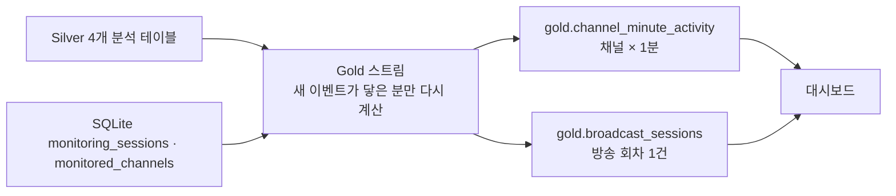

# Gold 테이블 설계 및 데이터 계약 v1

작성일: 2026-10-14. 상태: **Gold 스트림·전체 재계산·대시보드 구현 및 실제 데이터 대조 완료**. 방식을 고른 근거는 [Gold 실시간 갱신 방식 결정](decisions/2026-10-18-gold-live-refresh.md)과 [분 단위 증분 갱신 결정](decisions/2026-10-21-gold-minute-incremental.md)에 있다. 입력: Silver 파서 계약 `silver-v3.2` ([Silver 계약](silver-data-contract.md)).

Gold의 목적은 채널별 채팅·후원·구독 알림 흐름을 대시보드에서 바로 그릴 수 있는 집계 테이블을 만드는 것이다. 포트폴리오 데모에서 방송 한 회의 흐름과 요약을 보여주는 것을 1차 사용처로 한다.

## 1. 테이블과 한 행의 의미

| 테이블 | 한 행의 의미 | 주 사용처 |
|---|---|---|
| `gold.channel_minute_activity` | 한 채널의 KST 1분 구간 동안 Silver 이벤트 집계. 이벤트가 1건 이상인 분만 저장 | 방송 중 채팅량·참여자·후원 시계열 차트 |
| `gold.broadcast_sessions` | Collector `monitoring_sessions`의 모니터링 회차 1건 | 방송 요약 카드, 회차 간 비교, 수집 누락 표시 |

- 날짜는 **방송 날짜(`broadcast_date_kst`)** 하나만 쓴다. 회차 `started_at`의 KST 날짜다. 늦은 오후에 시작해 다음 날 새벽에 끝나는 방송(관측 17:09–03:40)도 시작한 날의 방송으로 묶는다. 자정을 넘긴 분 데이터도 회차의 방송 날짜를 따른다. 자정 이후에 시작한 방송은 그날 방송이다.
- 일 단위 테이블은 두지 않는다. 일별 화면은 `broadcast_sessions`를 `broadcast_date_kst`로 묶는다. 고유 참여자는 회차 간에 합산하지 않는다.
- 방송 회차는 CHZZK의 방송 ID가 아니라 Collector가 해당 채널을 수집한 구간이다. 방송 시작 후 Collector가 늦게 붙었다면 그 앞부분은 포함되지 않는다.
- 분 테이블은 이벤트가 없는 분을 0으로 채우지 않는다. 0 채우기는 대시보드에서 회차의 시작·종료 범위로 수행한다.

## 2. `gold.channel_minute_activity`

| 컬럼 | 타입 | 규칙 |
|---|---|---|
| `channel_id` | STRING | Silver channel_id |
| `minute_start` | TIMESTAMP | `event_time`을 분 단위로 내림한 UTC instant. 키 |
| `session_id` | BIGINT | 이벤트별로 같은 채널의 `[started_at, ended_at)`에 `event_time`이 들어가는 회차를 먼저 정한 뒤 분으로 묶는다. 회차 시작이 분 중간(예: 19:58:30)이어도 그 분의 이벤트가 회차에 속한다. 없으면 NULL |
| `broadcast_date_kst` | DATE | 해당 회차의 방송 날짜. 회차가 없으면 NULL |
| `chat_count` | BIGINT | chat_messages 행 수. `CBOTBLIND` 포함 |
| `blinded_chat_count` | BIGINT | 그중 `message_status=CBOTBLIND` |
| `unique_chatters` | BIGINT | chat_messages의 NULL이 아닌 `actor_user_id` 고유 수 |
| `donation_count` | BIGINT | donations 행 수 |
| `anonymous_donation_count` | BIGINT | 그중 `is_anonymous=true` |
| `donation_amount_currency` | BIGINT | `pay_type=CURRENCY`인 `pay_amount` 합. 단위는 원(2026-10-18 운영자 확인) |
| `other_pay_type_donation_count` | BIGINT | `pay_type≠CURRENCY` 후원 수. 금액은 합산하지 않음 |
| `subscription_notification_count` | BIGINT | subscription_notifications 행 수 |
| `subscription_gift_count` | BIGINT | subscription_gifts 행 수 |
| `first_event_at`, `last_event_at` | TIMESTAMP | 그 분의 첫·마지막 Silver 이벤트 시각. 회차 행의 첫·마지막 이벤트를 분 단위 행만으로 만들기 위해 둔다 |

키는 `(channel_id, minute_start, session_id)`다. 한 회차가 끝난 같은 분에 다음 회차가 시작하면 그 분은 회차별로 두 행이 된다. Collector 재시작은 같은 방송(`live_id`)이면 직전 회차를 다시 열므로 회차를 나누지 않는다. 다시 열린 회차는 꺼져 있던 시간만큼 이벤트가 비며, 10분 이상이면 공백으로 표시된다. 다시 열린 회차는 `ended_at`이 비므로 Gold가 진행 중 회차로 다시 계산하고, 이미 끝난 방송으로 확정한 행도 그때 교체된다. 다시 여는 것은 채널의 가장 최근 회차뿐이라 회차끼리 겹치지 않는다. `live-detail` 조회가 실패하면 열린 회차는 유지하고, 닫힌 회차는 다시 열지 않는다. ID 없이 열린 회차는 같은 방송이라는 근거가 없으므로, 재연결에서 ID를 받으면 `UNKNOWN`으로 닫고 새 회차를 연다. 고유 참여자는 분 단위로만 센다. 분 값을 더하면 같은 사람을 여러 번 세므로 회차나 시간대 고유 참여자로 합산하지 않는다.

## 3. `gold.broadcast_sessions`

| 컬럼 | 타입 | 규칙 |
|---|---|---|
| `session_id` | BIGINT | `monitoring_sessions.id`. 키 |
| `channel_id`, `channel_name` | STRING | 회차 기록값. 이름이 없으면 `monitored_channels.channel_name` |
| `started_at`, `ended_at` | TIMESTAMP | 회차 기록값. 진행 중이면 `ended_at=NULL` |
| `broadcast_date_kst` | DATE | `started_at`의 Asia/Seoul 날짜 |
| `stop_reason` | STRING | 원본 코드 보존 (`BROADCAST_ENDED`, `SERVER_SHUTDOWN` 등) |
| `duration_minutes` | DOUBLE | `ended_at`(진행 중이면 Gold 계산 시각) − `started_at` |
| `chat_count`, `blinded_chat_count` | BIGINT | 회차 구간의 채팅 수 |
| `chats_per_minute` | DOUBLE | `chat_count / duration_minutes` |
| `peak_minute_start`, `peak_minute_chat_count` | TIMESTAMP, BIGINT | 채팅 수 최대 분. 동률이면 이른 분 |
| `donation_count`, `anonymous_donation_count`, `donation_amount_currency`, `other_pay_type_donation_count` | BIGINT | 2절과 같은 정의 |
| `subscription_notification_count`, `subscription_gift_count` | BIGINT | 2절과 같은 정의 |
| `first_event_at`, `last_event_at` | TIMESTAMP | 회차 구간 안 첫·마지막 Silver 이벤트. 회차 분 행 값의 최소·최대 |
| `active_minutes` | BIGINT | 이벤트가 1건 이상인 분 수 |
| `max_gap_minutes` | DOUBLE | 회차가 걸친 달력상의 분 중 이벤트가 없는 분이 가장 길게 이어진 수. 정수 값 |
| `data_status` | STRING | 아래 규칙 |

`data_status`는 "조용했던 방송"과 "수집이 안 된 방송"을 대시보드에서 구분하기 위한 표시다. 회차 기록은 Collector가 "이 시간에 수집하고 있었다"고 남긴 구간이다. 그 구간에 Silver 이벤트가 없다면 시청자가 조용했거나, Collector·Kafka·Bronze·Silver 중 어딘가에서 데이터가 빠진 것이다. Gold만으로 둘을 확정할 수 없으므로 의심 구간을 드러낸다.

공백은 회차가 걸친 달력상의 분(`started_at`의 분부터 종료 직전의 분까지) 중 이벤트가 없는 분이 이어진 길이다. 시작 분 → 첫 이벤트 분, 이벤트 분 사이, 마지막 이벤트 분 → 마지막 분을 모두 본다. 앞뒤 구간을 포함하는 이유는 Collector가 붙어 있었는데 데이터가 처음이나 끝에 없는 경우도 누락이기 때문이다. 대시보드 차트가 칠하는 빈 구간과 같은 규칙이다. 이벤트 시각 사이를 초 단위로 재지 않는 이유는 회차 행을 분 단위 행만으로 만들기 위해서다. 10분 경고 기준에서 1분 안쪽 차이는 판정을 바꾸지 않는다.

회차 행의 모든 값은 분 단위 행에서 만든다. 합계는 분 값의 합, 피크는 분 값의 최대, 첫·마지막 이벤트는 분 값의 최소·최대, 공백은 이벤트가 있는 분 사이의 거리다. 그래서 회차 전체 기준 고유 참여자는 두지 않는다. 같은 사람이 여러 분에 나오므로 분 값으로 만들 수 없고, 정확히 세려면 갱신마다 회차의 Silver 이벤트를 처음부터 다시 읽어야 한다.

| 값 | 조건 | 대시보드 표기 |
|---|---|---|
| `NO_DATA` | 회차 구간에 Silver 이벤트가 0건 | 수집 데이터 없음 |
| `CHECK_GAP` | `max_gap_minutes ≥ 10` | 수집 공백 확인 필요 |
| `OK` | 그 외 | 표시 없음 |

10분은 관측 근거가 있는 임계치가 아니라 초기 경고 기준이다. 채팅이 적은 방송은 정상이어도 `CHECK_GAP`이 될 수 있으므로 "누락 확정"이 아니라 "확인 필요"로 표기한다. 여러 채널에서 같은 시각에 공백이 나면 방송이 아니라 수집 장애일 가능성이 높지만, 이 교차 판정은 v1에 넣지 않는다.

## 4. 분석 계약

- 채팅량은 수신한 일반 채팅 전체(`CBOTBLIND` 포함)다. 가려진 채팅을 뺀 값은 `chat_count − blinded_chat_count`로 표시하고 이름을 따로 붙인다.
- 후원·선물 메시지는 채팅량에 포함하지 않는다(Silver에서 이미 테이블이 분리됨).
- 후원 금액은 `pay_type`별로 구분한다. `CURRENCY`의 단위는 원이다(2026-10-18 운영자 확인). 다른 `pay_type`은 단위가 확인되기 전까지 금액을 합산하거나 원으로 표기하지 않는다.
- 구독 알림 수를 "신규 구독 수"나 "갱신 수"로 부르지 않는다. 구독 선물 수신 수를 전체 구독 수로 부르지 않는다.
- 후원자는 대부분 익명이므로(관측 약 85%) 고유 후원자 수 지표는 두지 않는다.
- `unclassified_events`와 `quarantine`은 Gold 지표에 넣지 않는다.

## 5. 계산 방식

`spark/silver_to_gold.py`는 두 모드로 실행한다. 두 모드는 같은 집계 함수를 쓰고, 범위만 다르다.

| 모드 | 실행 | 다시 계산하는 범위 | 용도 |
|---|---|---|---|
| 스트림 (기본) | Silver와 함께 계속 실행 | 새 이벤트가 닿은 분, 기록이 바뀐 회차의 구간, 그 분을 가진 회차와 진행 중인 회차의 요약 행 | 라이브 대시보드 |
| `--full` | 한 번 실행 후 종료 | 전체 | 최초 구축, 집계 규칙 변경 후 재구축, Silver 삭제 보정 |

### 5.1 스트림 모드

- Silver 분석용 네 테이블을 하나의 스트림으로 읽는다. 체크포인트는 `gold_checkpoint` 하나다. 마이크로배치마다 새 이벤트의 `(channel_id, event_time)`만 받아 채널별로 첫 분~마지막 분 범위 하나를 정한다.
- SQLite 기록이 Gold와 다른 회차(새 회차, 시작·종료 시각, 종료 사유, 채널, 채널 이름 변경)는 회차 구간 전체를 범위에 더한다. 회차의 시작·종료가 바뀌면 이벤트가 회차와 회차 밖 사이를 옮겨 다니므로, Gold에 저장돼 있던 첫·마지막 이벤트까지 늘리고 예전 채널에도 같은 범위를 더한다. 이벤트가 사라지거나 두 번 집계되지 않는다.
- 분 단위 테이블은 그 범위의 Silver 이벤트만 다시 읽어 집계하고, 범위 안의 행을 회차와 상관없이 Delta `replaceWhere`로 교체한다. 범위 안 이벤트를 모두 다시 읽어 덮어쓰므로 같은 배치를 다시 처리해도 결과가 같다.
- 회차 테이블은 다시 쓴 분을 가진 회차, 기록이 바뀐 회차, 진행 중인 회차(`ended_at` NULL)의 행을 교체한다. 값은 Gold 분 단위 행에서 만들고 Silver는 읽지 않는다. 진행 중인 회차는 새 이벤트가 없어도 길이·끝쪽 공백·상태가 바뀌므로 매번 다시 만든다.
- 그래서 진행 중인 회차가 길어져도 Silver를 읽는 양은 새 이벤트가 닿은 분만큼이다. 회차 행을 만들 때 읽는 분 단위 행은 회차 길이에 비례하지만 3시간 회차가 180행이다.
- 채널마다 범위를 하나로 묶으므로, 몇 시간 늦게 도착한 이벤트가 있으면 그 시각부터 지금까지 그 채널의 분을 다시 읽는다. 늦은 이벤트가 흔해지면 범위를 나눈다.
- 테이블마다 한 커밋이라 화면에 반쯤 지워진 회차가 보이지 않는다.
- Silver에 새 행이 없으면 마이크로배치가 돌지 않는다. 그래서 드라이버 타이머가 트리거 간격마다 새 이벤트 없이 갱신을 실행해 진행 중인 회차와 기록이 바뀐 회차를 반영한다. 스트림 스레드와 타이머는 잠금으로 직렬화한다.
- Gold가 처음 실행되어 Gold 테이블이 없거나, 분 단위 행에 `last_event_at`이 없는 예전 구조면 첫 갱신은 `--full`과 같은 전체 계산을 한다. 체크포인트 없이 시작한 스트림의 첫 배치는 Silver 전체를 받으므로 결과도 같다.
- Silver는 후원·선물 업무 키 충돌 때만 기존 행을 지운다(2026-10-14 기준 후원 710건 중 0건). 스트림은 `skipChangeCommits`로 그 커밋을 건너뛰어 멈추지 않는다. 지워진 행은 같은 분에 새 이벤트가 와서 그 분을 다시 읽거나 `--full`을 실행할 때까지 Gold에 남는다. 진행 중인 회차도 마찬가지다. Silver 로그의 `removed`가 0보다 크면 `--full`을 실행한다.
- Gold 스트림은 Silver 출력 잠금을 잡지 않는다. Silver 여섯 테이블은 원자적으로 커밋되지 않으므로 한 트리거 동안 채팅과 후원이 한 배치 어긋나 보일 수 있고, 다음 트리거에서 맞춰진다.
- 같은 Gold 출력에 쓰는 작업은 `gold/.writer.lock`으로 하나만 허용한다. `--full`은 Gold 스트림을 멈춘 뒤 실행한다.

### 5.2 `--full` 모드

- Silver 네 테이블을 시작 시점의 Delta 버전으로 고정해 읽고 Gold 두 테이블을 덮어쓴다. Silver 출력 잠금도 잡으므로 Silver 스트림을 멈춘 뒤 실행한다.
- 2026-10-14 기준 이벤트 18만 건에 약 12초다. 비용은 Silver 누적량에 비례하므로 평소 갱신에는 쓰지 않는다.

### 5.3 공통

- 트리거 간격은 Bronze `spark.streaming.trigger.interval`, Silver `app.silver.trigger.interval`, Gold `app.gold.trigger.interval`이다. 층별 키가 없으면 Bronze 값을 따른다. 로컬 기본값은 5초·10초·10초다. 간격은 처리 시간보다 길게 둔다(측정: Silver 배치 약 3.5초, Gold 새 이벤트 갱신 약 2.2초·타이머 갱신 약 0.9초이며 회차 길이와 무관. [분 단위 증분 갱신 결정](decisions/2026-10-21-gold-minute-incremental.md) 3절).
- SQLite는 Python 표준 `sqlite3`로 읽기 전용으로 연다. 회차 수가 작아 Spark JDBC 드라이버를 추가하지 않는다.
- 한 채널의 회차 구간이 겹치거나 종료가 시작보다 앞서면 이벤트가 두 번 집계되거나 빠지므로 Gold를 멈춘다. 연속한 회차(앞 회차 종료 = 다음 회차 시작)는 허용한다. Collector는 두 시각을 같은 시계로 기록하고 채널의 열린 회차를 재사용하므로, 이 오류는 SQLite를 손으로 고쳤거나 시계가 뒤로 점프했을 때만 생긴다. 한 채널 때문에 모든 채널의 갱신이 멈추지만, 조용히 틀린 숫자를 보여주는 것보다 낫다고 판단했다. 복구 절차는 README에 있다.
- Collector는 회차 기록을 지우지 않는다. 손으로 지운 회차의 Gold 행은 스트림이 정리하지 않으므로 `--full`로 정리한다.
- 출력 경로: `data/output/local/frames/gold/<table>`(`app.gold.path`), 체크포인트 `data/output/local/frames/gold_checkpoint`(`app.gold.checkpoint.path`), SQLite `data/control.db`(`app.control.db.path`). `gold/_gold_manifest.json`에 마지막 계산 시각과 모드, 스트림은 다시 계산한 회차를, `--full`은 읽은 Silver 버전을 기록한다.
- 시간대 계산은 Spark 세션 `UTC`에서 한다. SQLite 시각은 `+09:00` 오프셋을 포함한 ISO 문자열이므로 instant로 변환한 뒤 비교하고, 방송 날짜만 Asia/Seoul로 계산한다. PySpark `collect()`는 시각을 로컬 시간대의 naive datetime으로 돌려주므로 드라이버 쪽 비교는 epoch 마이크로초로 한다.

## 6. 대시보드

- Gold 대시보드는 Collector와 분리된 FastAPI 프로세스로 실행한다. Collector 앱은 시작할 때 Kafka 발행기를 띄우고 활성 채널 수집을 복구하므로, 분석 화면을 보기 위해 Kafka와 수집을 켜지 않도록 분리한다.
- 화면은 기존 대시보드와 같은 Jinja 템플릿에 Chart.js를 CDN으로 불러와 그린다. 기존 Collector 대시보드에는 Gold 대시보드로 가는 링크만 둔다.
- Gold Delta는 `deltalake`(delta-rs) Python 패키지로 직접 읽는다. Spark를 띄우지 않으며, 별도 JSON 복사본을 만들지 않는다. 이 의존성은 대시보드 전용 requirements에만 넣고 Collector 이미지에는 추가하지 않는다.
- 대시보드는 Gold를 읽기만 한다. 10초마다 다시 읽고, 화면에 `_gold_manifest.json`의 계산 시각을 표시한다.
- 초 단위 "지금 채팅 속도"는 Collector의 기존 최근 60초 통계 API에서 가져온다. Gold와 별개의 빠른 길이며, Collector가 꺼져 있으면 그 칸만 꺼짐으로 표시한다.
- 화면 구성: 시청자용 서비스처럼 채널을 골라 들어가는 흐름이다. 내부 용어(Gold, 회차, Collector) 대신 "방송"과 "업데이트 n초 전"을 쓴다.
  - 홈: 지금 방송 중인 채널(LIVE, Collector 최근 60초 채팅/분), 채널 카드(방송 수, 방송당 평균 채팅, 최고 분당 채팅, 최근 방송 추세), 모든 채널의 최근 방송
  - 채널(`#/channel/<id>`): 방송당 평균 채팅·평균 길이(끝난 방송만), 지금까지 받은 후원 금액(건수는 보조 표시), 가장 붐빈 순간, 방송별 채팅 막대(막대를 누르면 그 방송으로 이동), 방송 기록
  - 방송(`#/channel/<id>/broadcast/<session_id>`): 지표 탭으로 바꾸는 분 단위 차트와 최고점·비어 있는 구간(채팅한 사람 탭의 큰 숫자는 가장 많았던 1분의 값), 보조 지표(가장 긴 빈 구간 포함), 시간대별 차트, 같은 채널의 다른 방송. 이벤트가 없는 분은 0으로 채워 그린다. 진행 중인 방송은 Gold가 그 행을 계산한 시점(`started_at + duration_minutes`)까지 그린다. 매니페스트는 테이블 뒤에 쓰이므로 끝 시각을 매니페스트에서 가져오지 않는다.
  - 후원은 금액(`donation_amount_currency`)을 큰 숫자와 차트 기준으로, 건수·익명 건수를 보조로 보여준다. `CURRENCY` 금액은 원으로 표시한다.
  - 상태 표시: `CHECK_GAP`은 "일부 구간 비어 있음", `NO_DATA`는 "수집된 채팅 없음", 진행 중은 LIVE
- 구현: `dashboard/app.py`, `dashboard/templates/gold.html`. API는 `GET /api/sessions`(회차 목록과 계산 시각), `GET /api/sessions/{id}`(회차 요약, 분 단위 점, 긴 공백 구간), `GET /api/live`(Collector 최근 60초)다.
- 차트의 공백 구간은 이벤트가 없는 분이 `gap_minutes`(10분) 이상 이어진 구간이다. `data_status`와 같은 분 단위 규칙이다.

## 7. 현재 데이터에서 예상되는 모습

| 항목 | 값 |
|---|---|
| 채널 | 6개. 9/19 두 채널은 회차 기록과 채널 등록이 모두 없음 |
| 회차 밖 분 | 9/19 데이터는 `session_id=NULL`, `broadcast_date_kst=NULL`로 분 테이블에만 존재 |

2026-10-14에 Silver `silver-v3.2`와 SQLite로 계산한 회차별 결과다. 구현 전 독립 계산과 Gold 배치 결과가 일치했다. 시각은 KST다. 공백은 당시 규칙인 이벤트 시각 기준이며, 지금 Gold는 빈 분 수로 세므로 1분 안쪽 차이가 난다.

| 회차 | 방송 날짜 | 수집 구간 | 이벤트 있는 분 / 회차 길이(분) | 가장 긴 공백 | 상태 |
|---|---|---|---:|---|---|
| 1 | 9/22 | 17:09–03:40 | 477 / 631 | 66.1분 (01:01–02:07) | `CHECK_GAP` |
| 2 | 9/22 | 17:10–03:08 | 474 / 599 | 66.1분 (01:01–02:07) | `CHECK_GAP` |
| 3 | 9/22 | 19:58–00:27 | 270 / 269 | 0.5분 | `OK` |
| 4 | 9/22 | 19:58–03:23 | 306 / 445 | 66.1분 (01:01–02:07) | `CHECK_GAP` |
| 5–8 | 9/23 | 14:22–다음 날 10:38 등 | 0 | 전체 | `NO_DATA` |

- 이벤트 있는 분은 회차가 걸친 달력상의 분을 센다. 3번처럼 회차가 분 중간(19:58:30, 00:27:44)에 시작·종료하면 회차 길이보다 클 수 있다.
- 01:01–02:07 공백은 그 시각에 수집 중이던 세 채널(1·2·4)에 똑같이 있다. 하루 채팅 8만 건 규모의 채널도 포함되므로 방송이 조용했다기보다 수집 장애로 보인다.
- 02:53 이후 공백은 Bronze Spark가 9/23 02:52부터 오류를 내기 시작한 시각과 맞는다. Bronze는 08:00에 종료됐고 이후 Collector도 Kafka 연결 실패를 기록했다. 5–8번의 `NO_DATA`는 이 중단 때문이다.
- 5번 회차는 20시간 넘게 이어지다 `SERVER_SHUTDOWN`으로 끝났다. Collector가 방송 종료를 확인하지 못한 구간이 포함됐을 수 있으므로 회차 길이를 방송 길이로 단정하지 않는다.

## 8. 범위 밖

- 키워드·이모티콘 등 텍스트 지표
- 1초 미만 지연. Delta는 배치마다 파일과 로그를 커밋하므로 이 구조의 목표가 아니다.
- 9/23–24 누락분 복구
